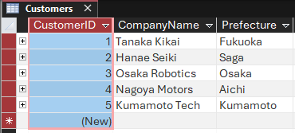
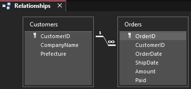
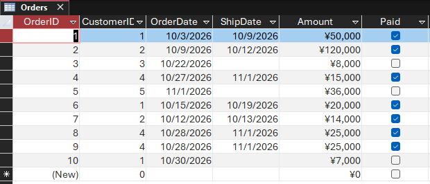
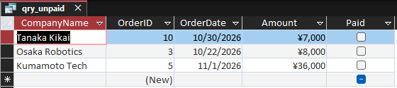
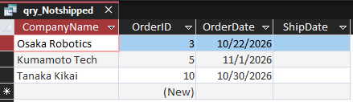
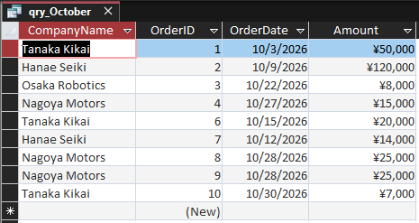
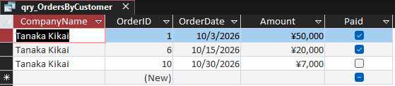
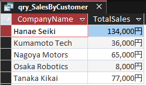
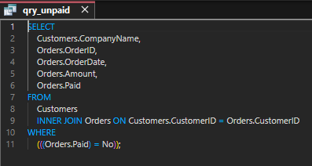
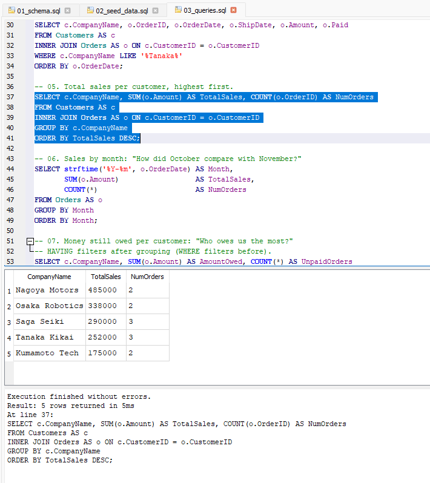

# SQL & Microsoft Access Practice: Customer Orders Database

A small customer orders database, built first in **Microsoft Access** and then rebuilt in **SQLite** so anyone can run the queries on any operating system.

I built it to prepare for an interview for an in-house IT role at a manufacturing company. The role involved pulling order, shipping and payment data from an Access database for the sales team. I started with no Access experience and finished the database, the relationship and all five queries in one evening, then wrote everything up here.

> This is a practice project. All companies and figures are fictional.

---

## What it shows

| Skill | Where |
|---|---|
| Table design with primary keys and data types | `sqlite/01_schema.sql`, Access Design View |
| One-to-many relationship (one customer, many orders) | Access Relationships window, `FOREIGN KEY` in SQLite |
| `INNER JOIN` across two tables | Every query |
| Filtering with `WHERE`, `IS NULL`, `BETWEEN`, `LIKE` | Queries 01–04 |
| Parameter query (asks for input when run) | `access/04_qry_OrdersByCustomer.sql` |
| Aggregates with `GROUP BY`, `SUM`, `COUNT`, `HAVING` | Queries 05–07 |
| `LEFT JOIN` to find missing records | Query 08 |
| Exporting results to Excel for non-technical users | Access External Data → Excel |

Each query answers a real business question a sales or accounts team would ask, such as *"Which orders haven't been paid?"* or *"Who owes us the most?"*

---

## Repository structure

```
sql-access-practice/
├── README.md
├── access/                  # SQL copied from Access's SQL View
│   ├── 01_qry_Unpaid.sql
│   ├── 02_qry_NotShipped.sql
│   ├── 03_qry_October.sql
│   ├── 04_qry_OrdersByCustomer.sql
│   └── 05_qry_SalesByCustomer.sql
├── sqlite/                  # Portable version, runs anywhere
│   ├── 01_schema.sql        # Creates the tables
│   ├── 02_seed_data.sql     # Sample data
│   └── 03_queries.sql       # Queries 01–08
├── database/
│   └── OrdersPractice.accdb # The original Access database
└── screenshots/
```

---

## Database design

**Customers**

| Field | Type | Notes |
|---|---|---|
| CustomerID | AutoNumber / INTEGER | Primary key |
| CompanyName | Short Text / TEXT | |
| Prefecture | Short Text / TEXT | |

**Orders**

| Field | Type | Notes |
|---|---|---|
| OrderID | AutoNumber / INTEGER | Primary key |
| CustomerID | Number / INTEGER | Links to Customers |
| OrderDate | Date/Time / TEXT (YYYY-MM-DD) | |
| ShipDate | Date/Time / TEXT | Empty = not shipped yet |
| Amount | Currency / INTEGER | Yen |
| Paid | Yes/No / INTEGER (0 or 1) | |



---

## The queries

| # | Business question | Technique |
|---|---|---|
| 01 | Which orders haven't been paid? | `INNER JOIN`, `WHERE Paid = 0` |
| 02 | Which orders haven't shipped? | `IS NULL` |
| 03 | What was ordered in October? | `BETWEEN` on dates |
| 04 | Show every order for one customer | Parameter query (Access), `LIKE` |
| 05 | Total sales per customer | `GROUP BY`, `SUM`, `COUNT` |
| 06 | Sales by month | `strftime`, `GROUP BY` |
| 07 | Who owes us the most? | `WHERE` + `GROUP BY` + `HAVING` |
| 08 | Which customers have never ordered? | `LEFT JOIN` + `IS NULL` |

Queries 01–05 were built in Access. Queries 06–08 were added in the SQLite version to go a step further.

### Example: unpaid orders

```sql
SELECT c.CompanyName, o.OrderID, o.OrderDate, o.Amount
FROM Customers AS c
INNER JOIN Orders AS o ON c.CustomerID = o.CustomerID
WHERE o.Paid = 0
ORDER BY o.OrderDate;
```

| CompanyName | OrderID | OrderDate | Amount |
|---|---|---|---|
| Osaka Robotics | 3 | 2026-10-11 | 240000 |
| Kumamoto Tech | 6 | 2026-10-29 | 45000 |
| Osaka Robotics | 8 | 2026-11-04 | 98000 |
| Nagoya Motors | 9 | 2026-11-06 | 175000 |
| Tanaka Kikai | 10 | 2026-11-09 | 72000 |
| Saga Seiki | 12 | 2026-11-14 | 55000 |

### Example: total sales per customer

| CompanyName | TotalSales | NumOrders |
|---|---|---|
| Nagoya Motors | 485000 | 2 |
| Osaka Robotics | 338000 | 2 |
| Saga Seiki | 290000 | 3 |
| Tanaka Kikai | 252000 | 3 |
| Kumamoto Tech | 175000 | 2 |

### In Access

The Access database has its own sample data, so its figures differ from the SQLite examples above.

**The tables**




**qry_Unpaid**: orders not yet paid



**qry_NotShipped**: orders with no ship date



**qry_October**: orders placed in October



**qry_OrdersByCustomer**: parameter query, run with "Tanaka"



**qry_SalesByCustomer**: totals query



**The SQL Access generated** (SQL View of qry_Unpaid)



### In SQLite (DB Browser for SQLite)



---

## How to run it

**Option 1: DB Browser for SQLite (Windows, Mac, Linux; free)**

1. Install [DB Browser for SQLite](https://sqlitebrowser.org/).
2. **New Database** → save it as `orders.db` → close the table pop-up.
3. Go to the **Execute SQL** tab. Open `sqlite/01_schema.sql` and run it (F5). Then do the same with `02_seed_data.sql`.
4. **Write Changes** (Ctrl+S).
5. Open `sqlite/03_queries.sql`. Highlight one query and press **Ctrl+Enter** to run it on its own.

**Option 2: sqlite3 command line**

```bash
sqlite3 orders.db < sqlite/01_schema.sql
sqlite3 orders.db < sqlite/02_seed_data.sql
sqlite3 -header -column orders.db < sqlite/03_queries.sql
```

**Option 3: Microsoft Access (Windows)**

Open `database/OrdersPractice.accdb`. The saved queries are in the left-hand panel.

---

## Access SQL vs SQLite: what changed

| | Access | SQLite |
|---|---|---|
| Yes/No field | `Paid = No` | `Paid = 0` |
| Date literal | `#10/1/2026#` | `'2026-10-01'` |
| Wildcard | `Like "*Tanaka*"` | `LIKE '%Tanaka%'` |
| Empty value | `Is Null` | `IS NULL` |
| Asking the user for input | `[Enter part of name]` | No pop-up: edit the value, or use a parameter in code |
| Currency type | Currency | INTEGER (yen has no decimals) |

---

## What I learned

- How a one-to-many relationship lets one query pull data from two tables.
- Access's Design View writes SQL for you. Reading the SQL View after each query is a quick way to learn SQL.
- `WHERE` filters rows before grouping. `HAVING` filters the groups afterwards.
- A `LEFT JOIN` with `IS NULL` finds records that have no match, such as customers who have never ordered.
- Non-technical teams usually want the answer in Excel, so the export step matters as much as the query.

---

## About me

I'm Dan Gray, moving into IT and cybersecurity (GRC), based in Japan.

- LinkedIn: [linkedin.com/in/dan-gray-cyber](https://www.linkedin.com/in/dan-gray-cyber)
- Also see: [Active Directory home lab](https://github.com/dangray-cyber/ad-homelab)
